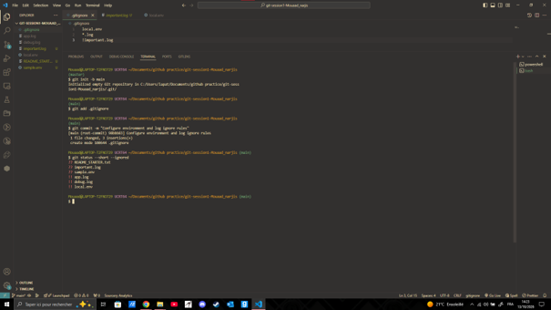

# Git Session 1

**Name:** Mouaad Narjis  
**GitHub username:** Mn99971

## Description

A project for practicing Git and GitHub fundamentals, including commits,
selective staging, branches, merging, and remote synchronization.

## Technologies

- Git
- GitHub
- Markdown
- Visual Studio Code

## Example command

```bash
git status
```

## Reference

[Git documentation](https://git-scm.com/docs)

## Image


